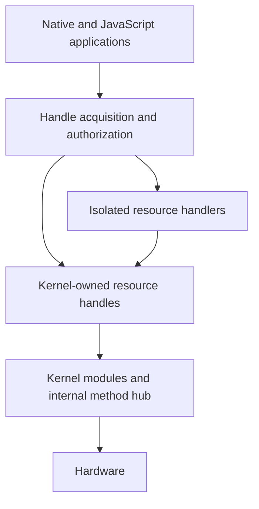
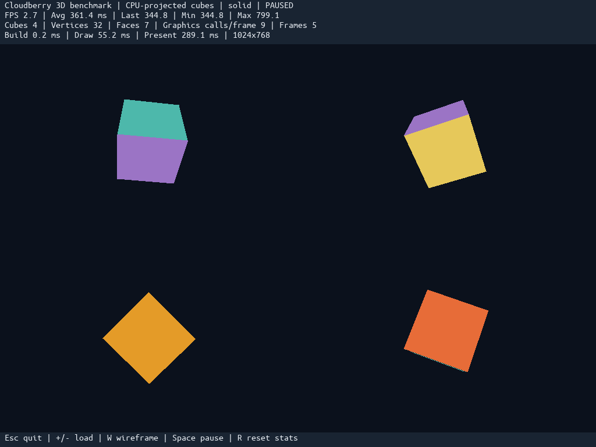

<p align="center">
  
</p>

# Cloudberry

**An experimental operating system built around replaceable services and explicit resource handles.**

I'm [Marcus Meneses](https://github.com/marcus-meneses), a software engineer
exploring how the way we build applications could influence the design of an
operating system. Cloudberry is my hands-on investigation of that question:
from boot and memory management to service contracts, application isolation
and graphical software.

The inspiration is the ship of Theseus. An application should keep working as
the implementations beneath it change. A filesystem, input provider or display
backend should be replaceable behind an established interface.

Another goal is an AI-friendly development platform: explicit contracts,
discoverable capabilities and reusable services that both people and development
tools can reason about. Location-independent access—keeping application contracts
stable across local and remote implementations—is part of that direction.
Today's system provides local kernel resources and cross-process services.

## The architecture

Cloudberry has two distinct layers:

- **Kernel modules (`kmodules`)** implement tightly coupled kernel mechanisms:
  memory, scheduling, hardware discovery, interrupts and device transport. Their
  methods and tables are published through the kernel hub.
- **Resource handlers** are isolated processes that publish functionality through
  **handles**. Applications request named, versioned handles through the system
  library; manifests and OS policy determine the operations they receive.



For example, text rendering follows **text → graphics → display**. Applications
use the same graphics contract with the software framebuffer backend or the
qualified virtio/VirGL backend. Interface headers define the C ABI; process-local
C++ layouts and vtables stay outside that contract.

## What runs today

The active implementation targets modern Intel and AMD x86-64 PCs and is
developed primarily with QEMU/KVM. It includes:

- Limine/UEFI boot, protected user processes, preemptible kernel threads, SMP,
  guarded stacks and owned virtual memory.
- PCI/ACPI discovery, Intel/AMD CPU and IOMMU backends, xHCI USB input and hubs,
  and USB-storage, NVMe and AHCI storage transport.
- Journaled ext4, resource discovery, manifest authorization, users/groups,
  sessions and signed local application installation.
- Retained graphical surfaces, clipping/composition, TrueType text, a graphical
  mouse cursor and interchangeable software/virtio-VirGL rendering providers.
- A native C SDK, static ELF applications and a QuickJS-based JavaScript runner.

Cloudberry is an active systems project. Hardware coverage, compatibility and
performance continue to be validated; the detailed status lives in the
[technical documentation](src/README.md) and [roadmap](src/ROADMAP.md).

## Applications

The system image includes a terminal, file utilities, account/installation
management, a process monitor, native and JavaScript editors, and a 3D benchmark.
Utilities are applications launched by name; the terminal keeps a small set of
shell built-ins.

| Try in the terminal | Purpose |
| --- | --- |
| `help` | Discover available commands and applications |
| `editor` | Open the native graphical text editor |
| `js /system/script/samples/editor.js` | Run the JavaScript editor |
| `monitor` | Inspect processes, handlers, CPU time and memory |
| `bench3d` | Run rotating cubes with live rendering statistics |



*An actual guest screenshot from QEMU/TCG. The benchmark projects geometry on the
CPU and uses the public graphics handle; the displayed timings are specific to
that run. [Benchmark controls and measurements](src/apps/bench3d/README.md).*

## Build and run

On Ubuntu, the toolchain helper builds GCC/Binutils locally and prepares Limine,
QEMU and image-building tools:

```sh
./scripts/install-toolchain-ubuntu.sh
source .toolchain/env.sh
```

Python 3 and Pillow are also required by the image/visual tooling. Build the
image and start a VM:

```sh
make -C src build
make -C src run QEMU_ACCEL=kvm QEMU_CPUS=4 QEMU_GPU=virgl
```

KVM requires access to `/dev/kvm`; VirGL requires working host OpenGL support.
A software-emulated launch is available with `make -C src run`.

The VM uses Q35/PCIe, 512 MiB RAM, USB keyboard/mouse through xHCI, NVMe and SATA
media. Boot requests 1024×768 and handlers use the actual reported dimensions.
Outputs live under `bin/`. Despite its `.iso` filename, `bin/cloudberry.iso` is
a hybrid boot image containing the configured ext4 system volume.

The ordinary boot image is attached read-only. For temporary writable changes:

```sh
make -C src run QEMU_ACCEL=kvm QEMU_CPUS=4 QEMU_BOOT_WRITABLE=1
```

For a persistent development installation:

```sh
make -C src init-dev-disk
make -C src run-dev QEMU_ACCEL=kvm QEMU_CPUS=4 QEMU_GPU=virgl
```

The development VM boots its own image. These commands do not install or change
the host's bootloader. [Build and storage details](src/README.md).

## Explore the source

```text
src/
├── apps/         Native applications and system installation catalog
├── handlers/     Isolated resource providers
├── interfaces/   Versioned application-facing C contracts
├── sdk/          System library and native runtime adapters
├── kernel/       Bootstrap, module loading and mediation
├── kmodules/     Shared, Intel and AMD kernel components
├── boot/         Limine configuration and boot entry
├── maps/         Startup memory and filesystem designs
├── script/       JavaScript samples
├── tests/        Host checks and isolated guest acceptance
└── tools/        Compile-time image and SDK builders
```

Start with the [handle contracts](src/interfaces/README.md),
[kernel hub](src/kernel/hub.md), [startup architecture](src/maps/startup.md)
and [filesystem layout](src/maps/filesystem.md).
[Testing instructions](src/tests/README.md) describe the isolated acceptance
suites; [measurement scripts](scripts/README.md) collect repeatable host reports.

## Upstream components

Cloudberry builds on Limine, uACPI, lwext4, FreeType, QuickJS, Newlib and the
Ubuntu font family. Their license notices accompany the relevant sources,
fonts and packaged resources.
