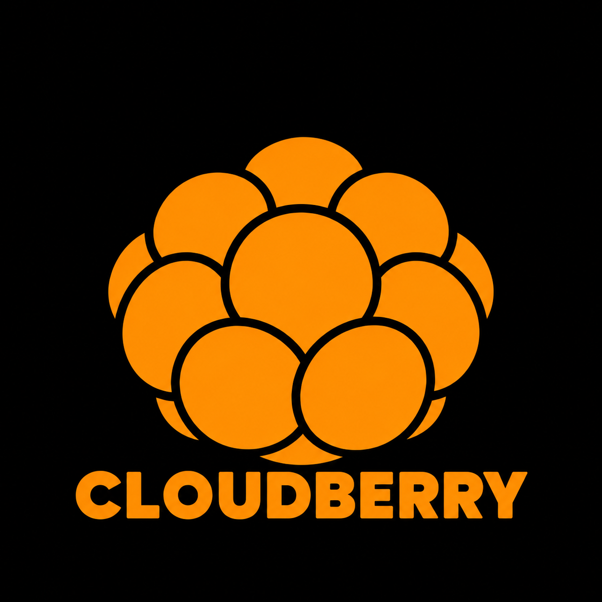

<p align="center">
  
</p>

# Cloudberry

An operating-system project exploring software built around explicit, replaceable
resource contracts.

I'm [Marcus Meneses](https://github.com/marcus-meneses), a software engineer.
Cloudberry is my way of exploring a question that reaches beyond kernel code:
**how much simpler could software become if the operating system made resources
interchangeable by design?**

## Why I'm building it

Applications spend substantial effort adapting to different libraries, services,
storage systems and communication mechanisms. I want to explore an OS where
applications request a capability through a defined interface, while the system
supplies the implementation and enforces access.

A filesystem could be local, remote or backed by an object-storage service.
The application would use the agreed filesystem contract. Differences in latency,
failures and supported operations would still be explicit; moving a resource
would not require rebuilding the application's integration around another API.

The original name, TheseOS, came from the Ship of Theseus: replace the parts while
preserving the identity of the whole. That remains Cloudberry's central idea.

I'm also interested in making this a platform where AI-assisted development is
practical: discoverable interfaces, versioned contracts, explicit permissions and
inspectable failures should help both people and development tools understand
what an application can do.

## The intended model

A **handler** provides a resource or service. A **handle** is an OS-granted
reference through which an application invokes its permitted operations.

The design calls for:

- Resource-specific operations behind versioned contracts, with reflection limited
  to the operations and data the caller is authorized to access.
- Application manifests declaring requested access, with OS-mediated authorization.
- A stable C ABI, first-class C support and C++20 developer wrappers, with future
  language bindings generated from interface definitions.
- Application-facing contracts that can span in-process, cross-process and remote
  providers, with explicit failure and execution semantics.

These are architectural goals. The current kernel modules are trusted, coupled
kernel components in a shared address space; they are the foundation underneath
that future handler/handle layer.

## What runs today

The active implementation boots through Limine and UEFI on modern Intel/AMD
x86-64 hardware, targeting machines from roughly 2016 onward. Development uses
QEMU with PCIe, NVMe, AHCI SATA and xHCI USB devices.

Implemented foundations include:

- Independently loaded kernel modules with a versioned method/table hub.
- Owned memory allocation, page mappings, guarded stacks and TLB coordination.
- Preemptible kernel threads, SMP startup, deadline scheduling and deferred IRQs.
- Calibrated clocks, cross-CPU TSC qualification and HPET fallback.
- Hardware/MMIO discovery, PCI ownership and initial Intel/AMD IOMMU backends.
- ACPI AML device enumeration, PCI firmware companions and a platform-device inventory.
- USB core with root/downstream enumeration, interface ownership and event-driven hotplug.
- External hub class module with nested topology and interrupt-driven port changes.
- Read-only NVMe and an xHCI transport with asynchronous transfers, hotplug
  detection and controlled controller restart.

User processes, application-facing handles, HID/storage class drivers, filesystems and runtime
ACPI notification/driver policy are still ahead. QEMU acceptance includes isolated one/four-CPU
runs with both emulated IOMMU models. AMD-host KVM validates the earlier SMP,
clock and extended-state foundation; native xHCI and physical-device validation
remain pending.

The [current assessment](src/README.md#current-assessment-2026-10-16) separates
implemented mechanisms, validation and remaining limits. Hub class-only restart and descriptor validation are complete. Next: implement
read-only USB storage and boot-volume matching, then load driver modules from disk. Process isolation follows that
foundation. The full sequence is tracked in the [roadmap](src/ROADMAP.md).

## Build and run

Follow the [Ubuntu toolchain setup](scripts/README.md) first, then run from the
project root:

```sh
make -C src build
make -C src run QEMU_ACCEL=kvm QEMU_CPUS=4
```

For software emulation, use `make -C src run QEMU_ACCEL=tcg`.
Build outputs live in `bin/`; the local cross-toolchain lives in `.toolchain/`.
Automated boot tests use separate images and disposable disks.

## Explore the project

- [Implementation overview and directory tree](src/README.md)
- [Roadmap and validation history](src/ROADMAP.md)
- [Kernel module contracts](src/kmodules/README.md)
- [Startup memory ownership](src/maps/startup.md)
- [Tests and acceptance evidence](src/tests/README.md)

The superseded implementation is preserved locally in `.src_old/`, outside Git
and the active build. The public repository tracks the current `src/` tree.
